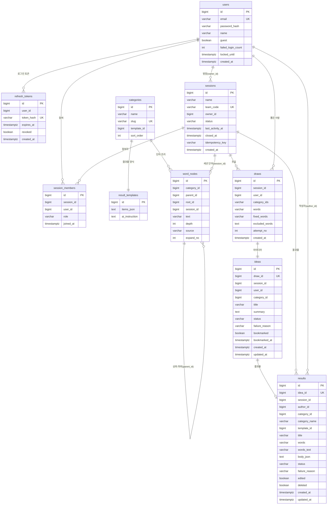

# Tree-Plan DB 설계

PostgreSQL 16 · 테이블 10개 · 지금은 JPA가 엔티티를 보고 스키마를 자동으로 만든다(`ddl-auto: update`).
아래 "현재 구조"는 실제 DB에서 뽑은 것(2026-10-19), "개선안"과 "다음 기능용 설계"는 제안이다.

## 1. 관계도 (ERD)

중심 흐름: **세션 → 추출(draws) → 아이디어(ideas) → 결과물(results)**. 히스토리는 별도 테이블 없이 results·ideas를 시간순으로 조회한다.

## 2. 테이블별 설명

| 테이블 | 역할 | 핵심 규칙 |
|---|---|---|
| `users` | 회원 + 게스트 | 게스트는 `guest=true`, 이메일은 `guest-<uuid>@guest.treeplan.local`. 로그인 5회 실패 시 `locked_until` 5분 |
| `refresh_tokens` | 로그인 유지 | 원문 대신 SHA-256 해시 저장. 한 번 쓰면 `revoked` |
| `sessions` | 발상 세션(팀 코드 단위) | `team_code` 6자리 고유. 상태 ACTIVE/CLOSED/EXPIRED. 30일 무활동이면 예약 작업이 EXPIRED로 |
| `session_members` | 세션 참여자 | (session_id, user_id) 고유. 역할 OWNER/MEMBER |
| `categories` | 고정 카테고리 3개 | slug: food · program · contest |
| `result_templates` | 분야별 결과물 양식 + AI 지시문 | `items_json` = [{key, label, description}] |
| `word_nodes` | 단어 트리 | 깊이 1 = 하위 카테고리(공용, `session_id` 없음). 깊이 2+ = AI 단어(세션별, `root_id`로 뿌리 표시). 가지 뻗기는 뿌리당 20번까지, 단어마다 `expand_no`(몇 번째 뻗기)를 저장해 서버가 셈 |
| `draws` | 단어 3개 추출 기록 | 단어 목록은 쉼표로 이은 문자열 |
| `ideas` | AI 아이디어 | 추출 1 : 아이디어 1 (`draw_id` 고유). 생성 상태 GENERATING/SUCCESS/FAILED |
| `results` | AI 실행안 | 아이디어 1 : 결과물 0..1 (`idea_id` 고유). 본문은 `body_json`({key: 내용}). 삭제는 `deleted=true`(소프트 삭제). 조회를 빠르게 하려고 단어·카테고리명·제목을 복사해 둠 |

## 3. 현재 구조의 문제와 개선안

| 우선 | 문제 | 왜 문제인가 | 개선안 |
|---|---|---|---|
| 1 | **외래 키(FK)가 하나도 없음** | 세션을 지워도 참여자·추출·결과물이 남는 등 고아 데이터가 생길 수 있음. 잘못된 ID도 그대로 저장됨 | 주요 관계에 FK 추가 (`session_members→sessions/users`, `draws→sessions`, `ideas→draws`, `results→ideas` 등) |
| 2 | **마이그레이션 도구 없음** (`ddl-auto: update`) | 컬럼 이름 변경·삭제가 반영되지 않고, 팀원마다 DB 모양이 달라질 수 있음. 배포 DB에서 위험 | Flyway 도입: 지금 스키마를 `V1__init.sql`로 고정하고 이후 변경은 `V2__...sql`로 |
| 3 | **게스트 데이터가 계속 쌓임** | 로그인하지 않고 나간 게스트의 세션·단어·결과물이 지워지지 않음("나가면 저장되지 않습니다"와도 어긋남) | 예약 작업으로 7일 지난 게스트 사용자와 그 데이터를 삭제 |
| 4 | 자주 쓰는 조회에 인덱스 없음 | 사용자가 늘면 히스토리·로그인 유지가 느려짐 | `session_members(user_id)`, `refresh_tokens(user_id)`, `draws(session_id, user_id)`, `word_nodes(session_id, category_id)` 인덱스 추가 |
| 5 | 목록을 쉼표 문자열로 저장 (`words`, `fixed_words`, `category_ids`) | 단어에 쉼표가 들어가면 깨짐. DB에서 검색·집계가 어려움 | PostgreSQL `text[]` 또는 `jsonb`로 변경 |
| 6 | JSON을 `text`로 저장 (`body_json`, `items_json`) | DB가 JSON 형식을 검사하지 못함 | `jsonb`로 변경 |
| 7 | 단어 중복 방지를 서버 코드만 담당 | 동시에 두 요청이 오면 같은 단어가 두 번 저장될 수 있음 | (session_id, category_id, 정규화한 단어) 고유 제약 |

> 중간발표에는 지금 구조로 충분하다. 1·2·3은 배포·사용자 테스트(12주차) 전에 하는 것을 권장.

## 4. 다음 기능용 설계 (제안)

### 11주차: 사용자 정의 카테고리·단어
기존 테이블을 넓혀서 해결하고 새 테이블은 만들지 않는다.

| 테이블 | 추가 컬럼 | 설명 |
|---|---|---|
| `categories` | `owner_id` (null = 기본 카테고리), `session_id` (null = 개인) | 사용자가 만든 카테고리. 결과물 양식은 기본 양식 하나를 같이 쓰거나 새로 만든다(팀 결정 필요) |
| `word_nodes` | (`source`에 `USER` 값 추가) | 사용자가 직접 넣은 하위 카테고리·단어. 뿌리당 가지 뻗기 20번 규칙은 그대로 |

### 11주차: 단어별 연결 이유·개선 질문
`result_templates.items_json`에 항목(`word_links`, `questions`)만 추가하면 된다. **스키마 변경 없음.**

### 10주차: 실시간 동시 편집
| 대상 | 설계 | 이유 |
|---|---|---|
| `results` | `version` 컬럼 추가 (낙관적 잠금) | 두 사람이 같은 결과물을 동시에 저장하면 나중 사람에게 "다른 사람이 먼저 고쳤어요"를 알려 덮어쓰기를 막는다 |
| 새 테이블 `result_edits` (선택) | id, result_id, user_id, item_key, before, after, created_at | 누가 무엇을 고쳤는지 기록. 되돌리기·변경 표시에 사용 |
| 참여자 커서 위치 | **DB에 저장하지 않음** | 실시간 채널로만 주고받는 짧은 정보. 저장하면 쓰기가 너무 많아짐 |

## 5. 정리 순서 제안

1. (중간발표 후) Flyway 도입 + 현재 스키마를 V1로 고정
2. V2: FK·인덱스 추가, 게스트 정리 예약 작업
3. V3: `results.version` (10주차)
4. V4: `categories.owner_id/session_id` (11주차)
5. (여유가 있으면) 문자열 목록 → `text[]`, JSON → `jsonb`
